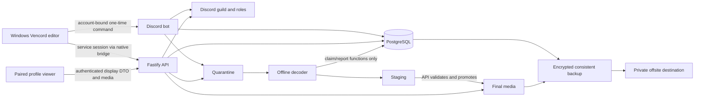
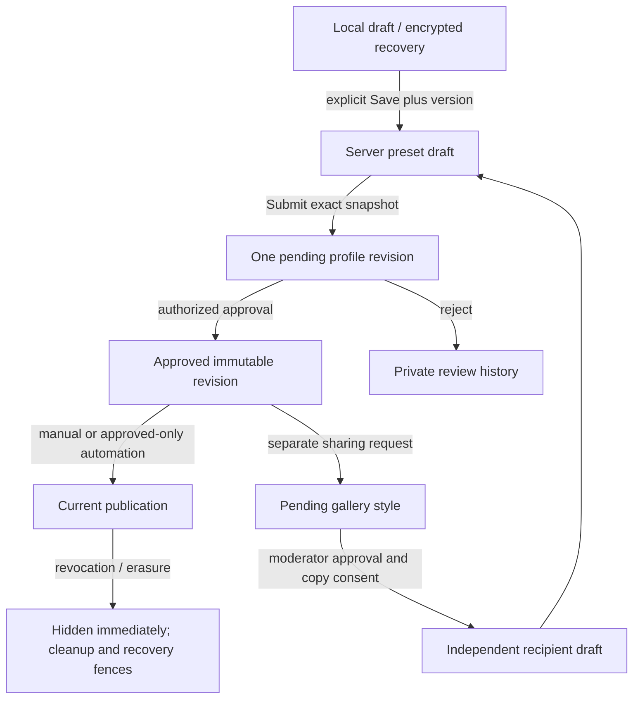

# Architecture and data flow

Profile Studio is a pinned Vencord userplugin plus an independently operated backend. A normal participant installs a prebuilt Windows package; only operators/developers need the source toolchain. The native Discord profile remains in place and Studio attaches moderated decorative scenes and blocks.

## Client responsibilities

`index.tsx` registers the Vencord lifecycle and native patches. `runtime.ts`, attachment/DOM modules and hover adapters discover supported profile surfaces; these are dynamic integration entrypoints, not unused code merely because a static tool cannot follow them. `native.ts` performs validated requests, encrypted local storage, isolated provider playback and owned-card export. Never replace the native trust boundary with arbitrary renderer fetches or shell commands.

`Editor` / `useEditorController` own legacy connection and account behavior. `StudioWorkspace` / `useWorkspaceController` own presets, editing history, submission and workspace state. Feature panels render typed state, while community panels enforce routing gates before loading private lists. See [module ownership](CODE-OWNERSHIP.md) and [editor consistency](EDITOR-CONSISTENCY.md).

Preview, live scenes and exports resolve the shared scene model. Effect phases are bound to a profile-opening session; ordinary React updates must not replay Intro. Shared scheduling pauses hidden scenes; private media leases keep active blobs alive and release them on unmount/access loss. [Resource lifecycle](RESOURCE-LIFECYCLE.md) documents soft cache budgets, request queues and native cancellation limits. These are encoded-media budgets, not guarantees about Chromium's decoded-image/GPU memory.

## Domain and backend

Pure types, defaults, tint palette and link helpers live in `packages/shared/domain`. Compatibility re-exports preserve old plugin import paths. The server/bot do not import plugin implementations. `scripts/plugin-source.mjs` assembles a self-contained plugin and rewrites the compatibility paths; copying `packages/plugin` alone is insufficient. See [Domain boundary](DOMAIN-BOUNDARY.md).

Fastify applies request/body limits, safe error/log serialization and authenticated route guards. `ProfileService` owns sessions, pairing, revisions, publication, erasure and media visibility. `StudioService` owns presets, library/sharing/provenance, controller leases and badges. Zod checks shape; transactions enforce concurrent state and ownership. Moderator decisions lock the exact submitted snapshot. Owner bypass of normal review still requires a fresh bot confirmation.

PostgreSQL uses separate migration/API/bot/worker roles. The decoder can claim and report leased jobs through narrow database functions; it cannot update approved profiles. It reads input, writes staging and has no internet/home-network access. Only API publication promotes verified output into final storage. Container and mounted-filesystem boundaries complement schema checks; they must be tested on the deployment host.

## Profile lifecycle

Saved presets, pending submissions and shared styles hold explicit media references. Retention cannot delete an asset while a valid retained object needs it. Importing an upload creates a quota-counted owned copy with provenance. Normal share withdrawal stops future copying; security removal and source deletion invalidate linked derived uploads. Recovery reapplies erasure/revocation fences before serving data and invalidates sessions.

## External services and trust

Discord provides account/guild/role checks and bot commands, not user-password authentication. Discord CDN metadata supplies catalog appearances without bundling store assets. Supported music providers supply metadata/artwork and explicitly opened playback. Steam supplies public game metadata/screenshots through the validated native client. There is no payment integration and no listening/game history collection.

The intended host uses an isolated Linux VM plus Tailscale Funnel and private encrypted Google Drive backups. Caddy/DuckDNS/Oracle examples remain alternative deployment recipes. Operator facts and locations must be verified separately; architecture diagrams do not establish a provider contract or a successful live security test.
