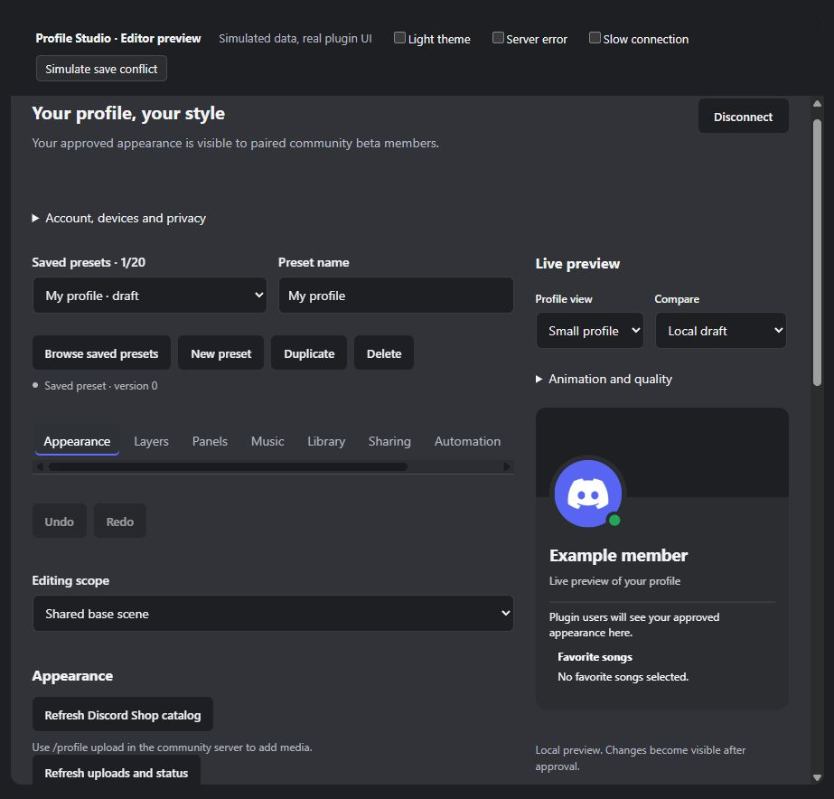

# Refactor development record

This is a sanitized milestone record. Private diagnostics, token logs, account data, exports and operational evidence are deliberately excluded. Availability in source does not certify production rollout.

## Assessment

The [feature inventory](assessment/FEATURE-INVENTORY.md) distinguishes implemented code paths from integration gates. [Measurement notes](assessment/MEASUREMENT.md) define reproducible comparisons. Baseline findings included duplicate client/server contracts, oversized editor responsibilities, bursty media downloads and repeated scene commits. Measurement did not justify reducing profile quality or user quotas.

## Shared contracts and module ownership

Stage 1A created [the shared domain boundary](DOMAIN-BOUNDARY.md) with compatibility wrappers and self-contained plugin assembly. Stage 1B separated editor/workspace controllers and feature panels; see [module ownership](CODE-OWNERSHIP.md). No Vencord upgrade, history rewrite or infrastructure replacement was performed.

## Resource work

Stage 2 introduced bounded media queues, byte accounting, active leases and stale-result fencing. The 80-source probe peaked at four downloads per pool, retained all active URLs and left zero entries after clear. Repeated isolated Electron scenarios removed steady-state React commits for CSS-only scenes. CPU/memory samples were too noisy for a production percentage claim. See [Resource lifecycle](RESOURCE-LIFECYCLE.md).

## Editor consistency

Stage 3 aligned navigation, fields, loading/error/empty/retry states and pinned preview layout. Synthetic browser tests covered dark/light themes, narrow layout, keyboard focus and nested scrolling. A fresh native Windows Discord/two-account acceptance pass remains open.

The historical user screenshots are not redistributed here. The public screenshot shows a synthetic account. No matching before-image exists from the same synthetic scenario, so a fabricated before/after comparison is not supplied.

## Documentation and privacy

The documentation package adds a separately built, searchable stable VitePress site, complete route inventory with reviewed contract-source drift detection, contributor/Supporter policy, source/licence inventory, and a public operator notice available before pairing. Operator-provided identity and intended host are recorded; unresolved legal/provider facts remain explicit rather than inferred.

No GitHub publication, production migration, native Discord installation/restart or paid hosting change is implied. Final deployment needs the [acceptance gates](ACCEPTANCE.md), an operator-completed notice and reviewed artifacts. Future feature ideas require discussion before becoming commitments.
