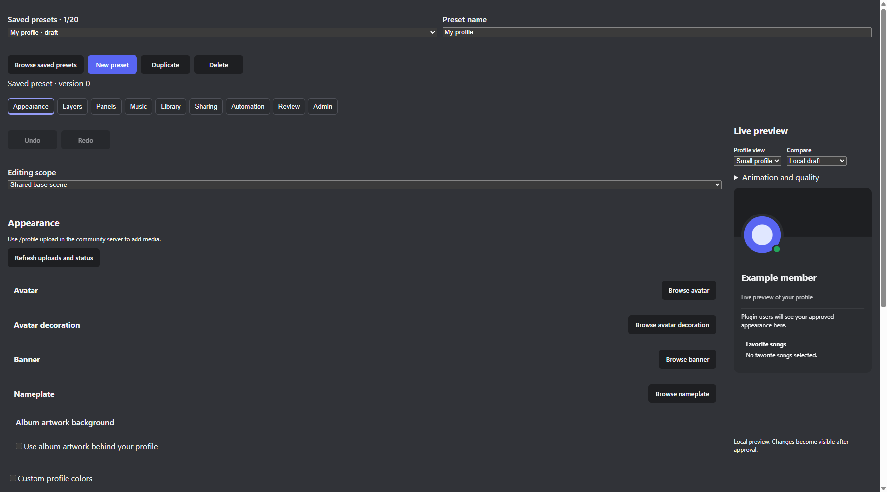
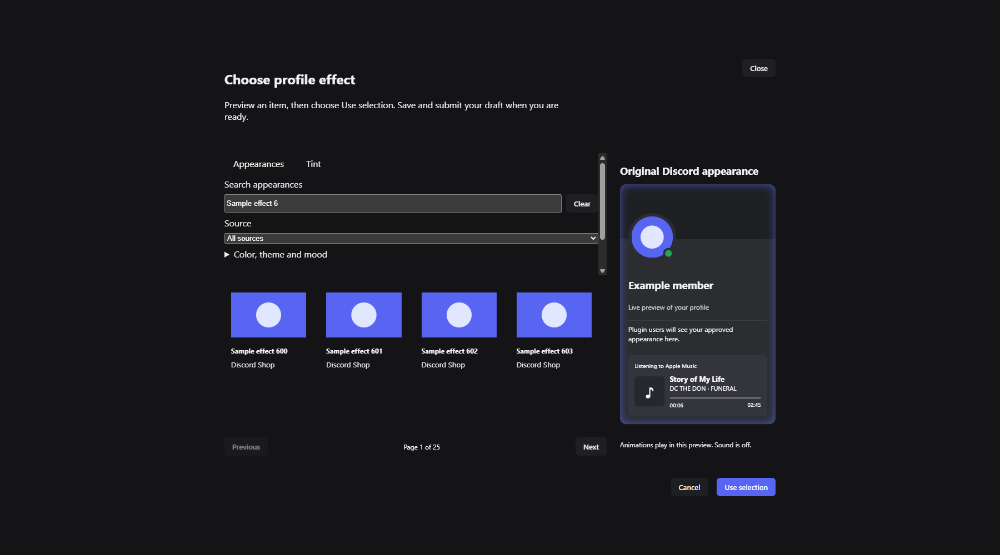
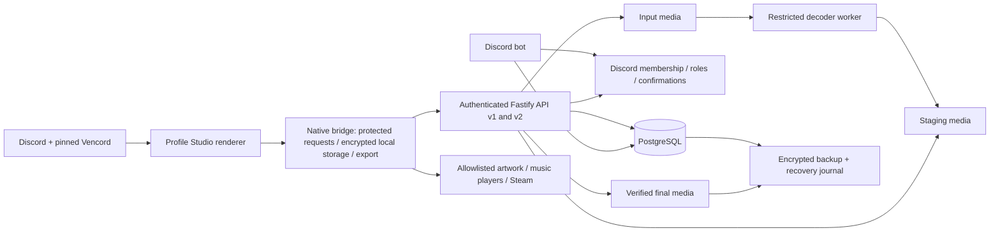

# Refactor assessment — Stage 0

Assessment date: 18 October 2026 (Europe/Budapest). Implementation baseline: `377b4a2e6fade416572c72cf0ace8608d3402c39`. Pinned Vencord: `32c90633ce6a95d7e56c95479efbb431bacf1eac`.

The source and laboratory assessment is delivered. Production code, profile formats, permissions, media limits and the deployed services have not been changed. This is an approval checkpoint for the subsequent refactor, not a completed redesign or public release.

## Decision

Proceed with a small domain-boundary refactor first, then measured lifecycle/cache work. Keep the existing API, bot, pairing, moderation and userplugin deployment. Do not rebuild the application around another platform.

The existing project already implements the 27-feature set in source. Several of its Discord/native integrations still need repeatable real-client acceptance evidence. These are separate from features that exist only in the new refactor plan: lint enforcement, the documentation site, route-contract coverage, the public privacy-notice endpoint and the revised contribution policy.

Read the [feature inventory](FEATURE-INVENTORY.md), [measurement protocol](MEASUREMENT.md) and [proposed budgets and acceptance targets](NEXT-STAGES.md) before approving another stage.

## Recovery and repository state

The initial branch had no normal commit or remote. A local `codex/refactor-baseline` branch now contains the scanned source, authored with the owner's verified GitHub noreply address. A Git bundle containing only that baseline commit and a source ZIP are retained in ignored private diagnostics. The bundle verifies independently. Private application recovery refs were not included in the bundle.

The baseline scan passed for 254 working-tree files, 271 pre-existing Git objects and the release ZIPs. This is evidence for the scanner's rules, not proof that arbitrary future data can be published. No GitHub repository was created, no remote was configured and no push occurred. Remote selection and publication remain release gates.

That commit predates the assessment tools/docs. The subsequent assessment commit contains those additions; its exact hash is recorded in the private manifest and the handoff. Reproduce using that assessment revision, whose `packages/` contents are identical to the source baseline.

Private baseline artifacts, hashes, raw measurements, command logs and model accounting are under `diagnostics/refactor-stage0/`, excluded from Git, source releases and container build context. Do not upload that directory. Restore instructions are in the private baseline manifest.

## Baseline verification

Current assessment checks passed: application typecheck (1.49 s), 191 Vitest tests across 42 files (155.75 s), 13 Node tests (3.14 s; five Linux-specific tests skipped on Windows), server build (1.37 s), preview build (0.75 s) and pinned Vencord/plugin typecheck (29.46 s). Native GIF checks separately passed three times. The existing Windows package also passed its integrity/corruption rejection test.

The global formatting baseline failed on four pre-existing files: the vendored GIF encoder and its licence, `tests/steam-games.test.ts` and `tests/windows-package.test.mjs`. New assessment code/docs pass formatting. No existing file was mass-formatted, and the third-party licence was preserved verbatim. There is no application lint gate yet. No new plugin ZIP, documentation-site build or Docker image was produced in Stage 0.

## Main findings, in priority order

1. **Module ownership needs correction.** There are 18 static imports from server, shared or bot modules into plugin modules, including three type-only imports. Pure model/schema/tint/music/ZIP helpers belong in the shared layer. Preserve the wire contract and provide compatibility re-exports while moving them.
2. **Media work lacks a global concurrency/byte budget.** The real `MediaUrlCache` started 80 synthetic downloads concurrently. All 80 observed entries survived its 64-entry eviction target, retaining 10 MiB in the deliberately small fixture. Identical requests coalesced and `clear()` revoked every object URL. The fix needs active leases, byte accounting and bounded downloads, rather than eviction of still-displayed media.
3. **Animated scenes repeatedly commit through React.** A visible three-layer synthetic profile produced about 17–19 React commits/second. Five visible profiles maintained five scheduled frame callbacks. Static and offscreen profiles settled with zero callbacks or commits. Preserve those working pause paths; move only the unnecessary per-frame React work. Offscreen Chromium CPU varied substantially, so no Discord CPU saving is claimed.
4. **Large components mix responsibilities.** The workspace is 1,524 lines, community tools 1,307, legacy/editor wrapper 1,213, server Studio service 897 and profile service 813. Split along state/data/render/native responsibilities. Line count identifies review hotspots, not a target to reduce mechanically.
5. **Documentation coverage is uneven.** The static inventory found 62 route registrations; only 26 route paths are mentioned anywhere in current Markdown docs. A mention is weaker than request/response/auth/error coverage. The privacy notice still contains operator placeholders and planned hosting text inconsistent with the observed VM/Funnel/Drive setup. Complete this before public publication; do not invent controller identity or provider region.
6. **Distribution is already small; development storage dominates.** The current Windows ZIP is 2,619,569 bytes (2.50 MiB), 6.26 MiB expanded. Its source maps occupy 3.99 MiB expanded. Separating optional debug maps may help, but corresponding source and licence notices must remain available. There is no justification for reducing profile image quality or deleting user media/backups. Docker layer sizes remain unmeasured because Docker image inspection requires operator sudo.
7. **Query count is a candidate, not an established bottleneck.** An empty synthetic workspace performs 11 counted database calls/request; `/v1/me` performs six. The current 50-member scope does not justify broad caching or new infrastructure without a production trace and permissions/invalidation review.

No source was deleted as “unused.” Reachability alone is unsafe for Vencord patches, native bridge exports, feature-gated panels, operator scripts, migrations and v1 compatibility.

## Measured baseline

Three fresh Electron processes used production React profiling, synthetic data, a 60 fps offscreen surface, a 700-item catalogue and three decorative layers. Each scenario had a 700 ms settling interval and nominal three-second observation. The exact observation duration is recorded, including delays. Two initial attempts were discarded: a background-throttled renderer and an API request count that reached its unchanged rate limit.

- Empty Electron shell: median 24.7 CPU ms during the observation; zero React commits.
- Static profile: median 24.0 CPU ms; zero scheduled animation frames after settling.
- Small animated profile: median 3,086 CPU ms across Electron processes; range 2,439–3,976 ms. This includes offscreen raster/GPU work and instrumentation, **not Discord CPU**. Median renderer heap was 3.38 MiB. Process working-set sums include shared pages and are not unique plugin memory.
- Full animated profile: median 18.9 React commits/second. Small and full use the same synthetic base configuration here; this is not a maximum-eight-panel height test.
- Idle editor with a plain preset: zero periodic React commits. The catalogue's CSS effect continued painting without React commits; zero React commits does not mean zero GPU/CPU work.
- Twenty open/close cycles per run: zero remaining tracked RAFs, intervals or timeouts and the original nine DOM nodes after unmount. Heap snapshots/forced GC and actual Discord document observers were not tested, so this is not a proof of no memory leaks.
- No unexpected external requests occurred. All provider art and API replies were synthetic. Actual Discord polling/download traffic is not represented by this fixture.

The isolated Fastify/PGlite benchmark used four synthetic accounts, 700 catalogue entries, a fresh database per process, five warmups and 12 measured serial requests/endpoint. Median across the three runs of each run's p95: health 4.8 ms, `/v1/me` 22.6 ms, workspace 26.6 ms, catalogue 10.9 ms. The catalogue first page was 60,429 bytes. These are small-sample laboratory results; they exclude network, Discord access checks and production PostgreSQL. PGlite's embedded WASM/database RSS must not be reported as server memory.

The native GIF correctness suite ran three times. It exported an ordinary two-frame animated card and a 3,000 CSS-pixel tall card with 20 photo layers, independently decoded both, checked the last panel and tested cancellation. Median suite time was 4.79 seconds (range 4.77–9.25). Sampled peak sum of Electron working sets was 703–744 MiB; the suite includes startup and synthetic stress, not a full-duration user recording. Output sizes were 4,165 and 412,813 bytes. No height restriction was reintroduced.

Read-only cgroup inspection provided a ten-second **idle** VM sample without sudo: API about 66 MiB, bot 62 MiB, worker 31 MiB, database 35 MiB and egress guard 12 MiB. Together they used about 2.2% of one CPU core in that short window. Host health returned OK and the root filesystem had about 23 GiB free. The running image was not correlated to the source baseline. These observations do not establish 50-user capacity or Funnel bandwidth.

## Dependencies and source

The root lockfile contains 332 dependency entries, including optional/platform packages, with ten direct production dependencies. The assessment-time `npm audit --omit=dev` reported zero known vulnerabilities. That is a point-in-time advisory check, not a security certification.

Production uses Fastify and its plugins, discord.js, PostgreSQL/pg, Sharp, Zod and dotenv. Development/build tools include TypeScript, React for fixtures, Vite, Vitest, PGlite, esbuild, Prettier and FFmpeg/FFprobe test binaries. Runtime decoding uses the distribution's FFmpeg. The plugin integrates with Discord through the pinned Vencord webpack/native bridge; these internal interfaces require real Discord regression testing.

The project and pinned Vencord source use GPL-3.0-or-later. The GIF encoder has its own retained notice. Lockfile licence metadata spans MIT, Apache, BSD/ISC, MPL and LGPL combinations; one entry has no declared licence. This is an inventory signal, not a complete licence review. A future software bill of materials must cover shipped npm packages, FFmpeg/Sharp native libraries, Vencord corresponding source and all retained notices. Discord Shop art and music streams are not bundled as project-owned assets.

## Evidence boundaries and remaining gates

The source inventory and isolated tests establish reproducible starting points. They do **not** replace these still-open checks:

- True Windows Discord CPU/memory, document observer churn, real animation/media traffic and two-account behavior, using the installed pinned build.
- Cold OS cache, sustained/full-duration GIF recording and cancellation during heavy real-media decode.
- Production image/layer size, sustained API/decoder load and 5 → 20 → 50-member capacity/Funnel measurements.
- Actual controller identity, hosting/backup location and privacy processing details confirmed by the operator.

No live restore, deployment, data export/deletion, role change, Discord restart or public release was performed during this assessment. The current source baseline can support the bounded structural stage; performance success and release readiness remain subject to the missing integration evidence.

## Synthetic visual baseline

These are isolated fixture screenshots, **not screenshots of Discord**. They contain no user profile, private media or third-party Shop artwork. Lossless WebP reduces the two captures to about 48 KiB combined.

## Architecture and data flow

The diagram shows operational responsibilities, not every network mount. Worker grants and network restrictions remain authoritative. The current source-layer dependency back toward plugin domain helpers is the first structural refactor target.

## Tools used

The approved React, doc-coauthoring and webapp-testing skills were installed outside project dependencies. React guidance was applied to measurements and lifecycle review; Next.js-specific rules were excluded. Documentation follows a context/structure/reader-review workflow. Electron fixture automation is used for native measurements; actual browser/Discord acceptance remains distinct.

Existing project design context, frontend-design, Awesome Design MD's Linear reference, Frontend Design Premium and Impeccable guidance inform the proposed UI stage. No Impeccable engine run succeeded in this environment. Mobbin requires paid access and was not upgraded. No Tripo/Higgsfield generation or paid asset work was performed.

## Measurement references

CPU counters are differenced from cumulative seconds, as described in [Electron CPUUsage](https://www.electronjs.org/docs/latest/api/structures/cpu-usage). Memory terminology follows [Electron process memory information](https://www.electronjs.org/docs/latest/api/structures/process-memory-info). Measurements and inferences above remain tied to this repository's fixtures, not those documentation examples.
